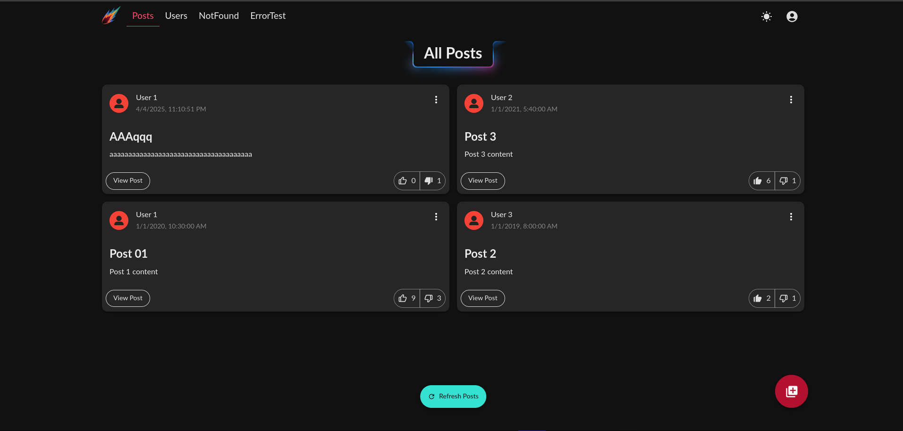
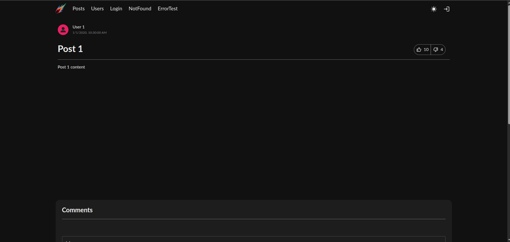
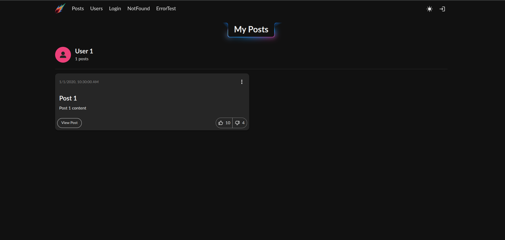
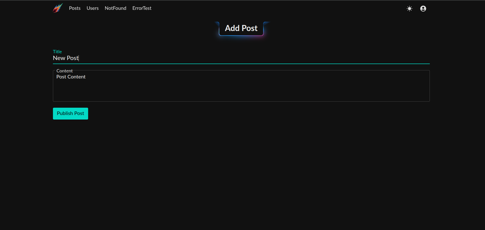

# Asteroid - social app
  
A front-end social-media app (think of a small weblog) where users can sign in, create, edit and delete posts, comment on other people's posts, and react with likes and dislikes.

I built Asteroid to compare **three different Redux architectures** on the same app, so the same features are implemented three times, one per branch.

> This README and repo are for the **`redux-core`** version.


## Screenshots


| Feed | Post Page |
|---|---|
|  |  |

| User Posts | Create Post |
|---|---|
|  |  |


## Features

- Sign in with form validation
- Create, edit and delete your own posts
- Comment on posts
- Like and dislike posts
- Toast notifications and error boundaries for failed requests
- Page titles managed per route


## Three Architectures, One App

| Branch | State management | Server requests / side effects |
| --- | --- | --- |
| [`redux-core`](https://github.com/parsa-farahani/REPO-NAME/tree/redux-core) | Redux (classic) | Redux-Saga for requests, Redux-Observable for listeners |
| [`rtk/async-thunk`](https://github.com/parsa-farahani/REPO-NAME/tree/rtk/async-thunk) | Redux Toolkit | `createAsyncThunk` |
| [`rtk/rtk-query`](https://github.com/parsa-farahani/REPO-NAME/tree/rtk/rtk-query) | Redux Toolkit | RTK Query |


## Tech Stack

| Area | Tools |
| --- | --- |
| UI | React 18, Material UI (`@mui/material`, Emotion) |
| Language | TypeScript |
| State | Redux, Redux-Saga, Redux-Observable (RxJS), React-Redux |
| Routing | React Router DOM |
| Forms | Formik + Yup |
| Data fetching | Axios |
| Feedback | React-Toastify, MUI Snackbar, React Error Boundary |
| Other | React Helmet Async, React Icons |


## Getting Started

**Prerequisites:** Node.js 18 or newer

```bash
# 1. Clone the repository and switch to this branch
git clone https://github.com/parsa-farahani/redux-social-app.git
cd redux-social-app
git checkout redux-core

# 2. Install dependencies (root and server)
npm install
cd server && npm install && cd ..

# 3. Start the app
npm start
```

Then open the URL that Vite prints in the terminal (by default [http://localhost:5173](http://localhost:5173)).

> **Note:** the app needs its API to work. The back end is a [json-server](https://github.com/typicode/json-server) mock API that lives in the `server/` folder, and it **must be running** while you use the app.
>
> `npm start` already handles this: it uses [`concurrently`](https://github.com/open-cli-tools/concurrently) to launch the Vite dev server and the json-server API together. If you only run `npm run dev`, the front end starts alone and requests will fail, so start the server yourself with `cd server && npm start`.

